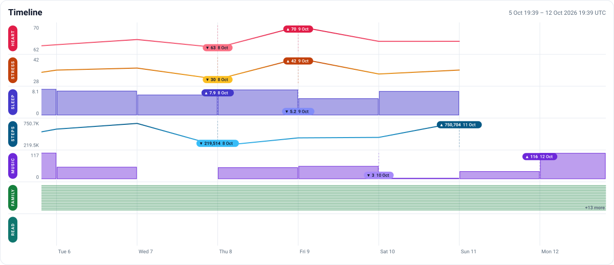
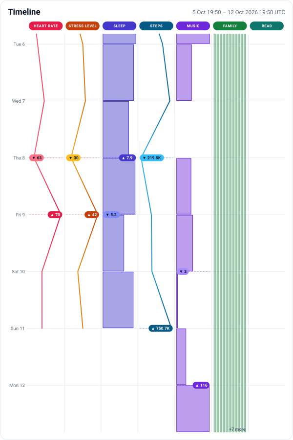

# timeline

## Embedding

`/embed.svg` draws the timeline as a self-contained SVG image, for other sites
to embed:

```html
<picture>
  <source
    media="(max-width: 600px)"
    srcset="
      https://timeline.jamesst.one/embed.svg?maxWidth=600px&end=now&duration=1w
    "
  />
  
</picture>
```

| Parameter  | Meaning                                                                                              |
| ---------- | ---------------------------------------------------------------------------------------------------- |
| `start`    | ISO 8601 time, or `now`.                                                                             |
| `end`      | ISO 8601 time, or `now`.                                                                             |
| `duration` | `24h`, `30d`, `1w`, ... Used when only one of `start` and `end` is given, or neither.                |
| `width`    | Canvas width in pixels, 200 to 2400. Defaults to 1200.                                               |
| `maxWidth` | Caps `width`, or sets it when `width` is absent; `600px` and `600` both work.                        |
| `height`   | Canvas height in pixels, 200 to 2400. Defaults to suit the layout.                                   |
| `layout`   | `horizontal`, `vertical` or `auto` (the default): vertical when taller than wide, or under 640 wide. |

`start` and `end` together win; otherwise one of them plus `duration`
(default a week); with neither, the week ending now. Times are UTC, and a
range must run between an hour and five years.

| `?end=now&duration=1w`                         | `?maxWidth=600px&end=now&duration=1w`      |
| ---------------------------------------------- | ------------------------------------------ |
|  |  |

The page itself is static (`packages.default`); the image needs a server,
`packages.embed`, which `nixosModules.default` runs as
`services.timeline-embed`. See `flake.nix` for the web server wiring.
