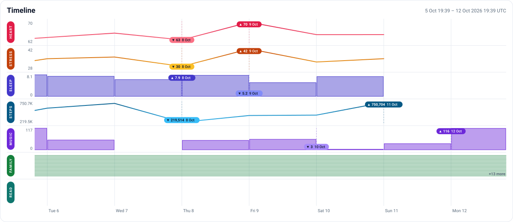
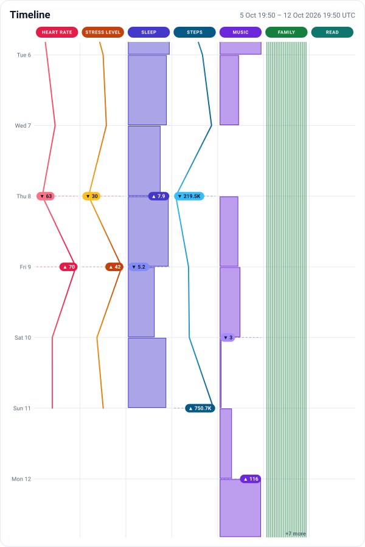

# timeline

## Embedding

`/embed.svg` draws the timeline as a self-contained SVG image, for other sites
to embed:

```html
<picture>
  <source
    media="(max-width: 600px)"
    srcset="
      https://timeline.jamesst.one/embed.svg?maxWidth=600px&end=now&duration=1w
    "
  />
  
</picture>
```

| Parameter  | Meaning                                                                                              |
| ---------- | ---------------------------------------------------------------------------------------------------- |
| `start`    | ISO 8601 time, or `now`.                                                                             |
| `end`      | ISO 8601 time, or `now`.                                                                             |
| `duration` | `24h`, `30d`, `1w`, ... Used when only one of `start` and `end` is given, or neither.                |
| `width`    | Canvas width in pixels, 200 to 2400. Defaults to 1200.                                               |
| `maxWidth` | Caps `width`, or sets it when `width` is absent; `600px` and `600` both work.                        |
| `height`   | Canvas height in pixels, 200 to 2400. Defaults to suit the layout.                                   |
| `layout`   | `horizontal`, `vertical` or `auto` (the default): vertical when taller than wide, or under 640 wide. |

`start` and `end` together win; otherwise one of them plus `duration`
(default a week); with neither, the week ending now. Times are UTC, and a
range must run between an hour and five years.

| `?end=now&duration=1w`                         | `?maxWidth=600px&end=now&duration=1w`      |
| ---------------------------------------------- | ------------------------------------------ |
|  |  |

The page itself is static (`packages.default`); the image needs a server,
`packages.embed`, which `nixosModules.default` runs as
`services.timeline-embed`. See `flake.nix` for the web server wiring.

## Public instance

`services.timeline` (in `nixosModules.default`, x86_64-linux) runs duckweb, which
renders each response from SQL over the public-safe sources: Last.fm, the
reading list, parkrun, chess, and sanitised Garmin rollups. `/` is the lane
timeline: the server draws an SVG three viewports wide and the page script pans
it by moving the viewBox, fetching a fresh window from `/lanes.svg` near an edge.
Without script the page is the same drawing at a fixed range, navigable by the
zoom links. `/sql` runs one read-only `SELECT` per request.

`nixosModules.default` does not import duckweb's NixOS module; the instances set
`services.duckweb`, so the consuming configuration must import
`duckweb.nixosModules.duckweb` itself.

The attach set is the permission boundary. The process is handed only the
`services.timeline.sources` files and a Garmin file produced by
`timeline-garmin-public`, which keeps sleep nights and daily aggregates and
nothing with a coordinate or a sub-day sample. `enable_external_access` is
switched off before the first request (DuckDB cannot turn it back on), and the unit
is capped by `MemoryMax`, `CPUQuota` and DuckDB's `memory_limit`. DuckDB has no
statement timeout, so those caps are the limit on an expensive query.

## Private instance

`services.timeline-private` is the same lane timeline over every source, for the
tailnet: `address` must be one interface (a wildcard fails evaluation) and no
public name points at it. It attaches the public sources and the Garmin rollups,
and for the SQL box the full Garmin snapshots (`garmin_full`, `garmin_summary`,
`garmin_activities`, `garmin_monitoring`), the chat snapshot (`chat`, a copy of
Synapse's database), optionally the chat `archive`, and `purifier`. It runs as
its own unit with its own state, looser caps, and the supplementary groups its
files need.

Two more lanes, chat volume and PM2.5, join the public ones. `/chat` shows
message counts by network and never a body; bodies are reachable through
`/chat/search?q=` (a plain substring of at least three characters, the newest
50 matches) and the SQL box (`chat_messages`). The public instance has neither
route.

The purifier recorder opens its DuckDB file read-write every minute, and a
reader's lock makes that tick fail, so the server never holds it. It attaches
`purifier.snapshot`, a SQLite file, which `timeline-purifier-snapshot
<status.duckdb> <out.sqlite>` writes by copy-then-rename; evaluation fails if
that option names a `.duckdb` file. The units that run the snapshot, and the
Garmin and chat snapshots arriving, are the host's: the server waits up to a
minute for its files at start and retries every 30 seconds after that.

`nix flake check` boots both modules in one NixOS VM (`checks.<system>.site-vm`)
over fixture databases, and asserts the lanes draw, the Garmin file carries no
location, the SQL box refuses writes, file access, `ATTACH` and reconfiguration,
the private instance sees the private catalogs and the public one still does
not, and no body, archive row or coordinate reaches a lane or the chat page.
`bun test web` covers the pan arithmetic.
